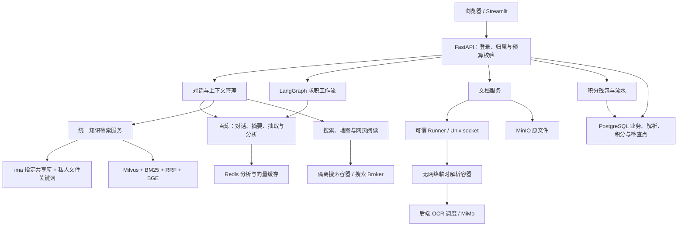
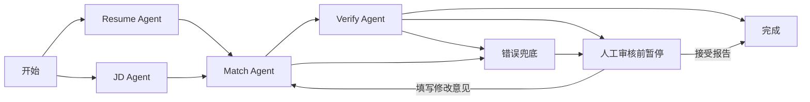

# 智能求职 Multi-Agent 系统：总体技术报告与面试讲解

版本日期：2026-10-23。依据：当前工作区代码、实际加载的非敏感配置、已安装依赖和本次测试。

阅读建议：先看第 1、2、6、16 节建立整体表达，再按面试官追问阅读认证、文档、检索、工作流、上下文和积分的实现细节。
文中的“已实现”指存在对应代码及已验证的行为，不代表已经完成生产压测或全面安全验证。

## 1. 项目定位与当前结论

这是一个面向求职者的智能辅助系统，围绕“上传资料—理解简历与岗位—生成匹配报告—准备面试—制定学习计划”构建业务闭环。
系统还提供工具增强对话、两种知识检索方式、用户数据归属、受限文档解析、模型预算和积分消耗管理。

核心技术路线是：

> Streamlit 提供交互界面，FastAPI 提供受保护的业务接口；LangGraph 编排简历、岗位、匹配和校验节点；PostgreSQL 持久化业务与检查点；MinIO 保存原文件；Milvus、BM25、BGE 组成本地混合检索；Redis 缓存重复计算；Docker 隔离文档解析和本地搜索工具任务。

当前主流程已经具备较完整的工程实现。本次现有自动化测试 **373 项通过**，但故障模拟与部署检查仍发现问题，详见 [代码审查记录](/Users/crazyzm/pythonCode/Intelligent_Career_System/docs/CODE_REVIEW_2026-10-23.md)。

面试中可以将其定位为“具备多用户鉴权、持久化工作流、RAG 与工具隔离的求职辅助项目”，暂不应称为“已经验证的高并发生产平台”或“每个用户拥有完整独立 Agent 运行环境”。

## 2. 整体架构与模块划分



图中的 OCR 是受控往返：解析容器提出 OCR 请求，后端持密钥调用服务商，再把识别文字传回容器；容器本身没有联网权限。
地图和网页阅读的实际运行边界与本地 MCP 搜索不同，见第 11 节。

| 模块 | 解决的问题 | 主要代码 |
|---|---|---|
| 前端页面与交互 | 对话、上传、匹配、计划、积分与评测展示 | `frontend/app.py`、`frontend/career_ui/` |
| 认证与数据归属 | 确认调用者，防止读取他人资源 | `backend/app/security/auth.py`、`api/auth_api.py` |
| 文档处理 | 安全解析多种格式，保留结构和位置 | `services/document_service.py`、`document_pipeline.py` |
| 沙箱控制 | 用固定受限容器执行不可信文档解析 | `deploy/sandbox/`、`services/sandbox_client.py` |
| 知识检索 | 统一接入 ima 与本地混合检索 | `services/knowledge_service.py`、`knowledge_policy.py` |
| 索引准备 | 为用户本地文档建立可恢复的向量索引 | `services/knowledge_index.py` |
| 求职工作流 | 并行抽取、匹配、事实校验、人工审核 | `agents/workflow.py` |
| 意图与上下文 | 对话路由、风险信号识别、摘要与预算 | `services/chat_intent.py`、`api/chat_api.py` |
| 模型与成本 | 对接模型、限制输出、记录用量与扣分 | `services/bailian.py`、`services/credits.py` |
| 缓存 | 复用简历/JD 抽取、Embedding 和评测状态 | `analysis_cache.py`、`embed_cache.py`、`experiment_store.py` |
| 评测 | 固定语料范围，比较检索与回答配置 | `backend/app/evaluation/` |
| 日志与资源限制 | 串联排障线索，限制调用、并发和耗时 | `core/access_log.py`、`logging_setup.py`、`limits.py` |

上表中的代码路径相对项目根目录。

## 3. 技术栈与实际配置快照

### 3.1 本机已安装版本

| 组件 | 本次检查的版本 | 用途 |
|---|---|---|
| FastAPI | 0.139.2 | API、依赖注入、SSE 响应 |
| Streamlit | 1.60.0 | 页面、组件和局部刷新 |
| LangGraph | 1.2.16 | 有状态工作流、并行节点和检查点 |
| langchain-openai | 1.5.1 | 对话工具调用及模型回调 |
| SQLAlchemy | 2.0.51 | 异步 ORM 与事务 |
| Pydantic | 2.13.4 | 请求和模型输出校验 |
| pymilvus | 2.5.18 | 向量库访问 |
| RAGAS | 0.3.9 | 四项官方评测指标 |

这是环境快照，不等于所有依赖已通过 lock 文件完全固定。

### 3.2 当前模型分工

| 工作 | 当前实际配置 | 实现说明 |
|---|---|---|
| 对话、简历/JD 抽取、匹配及计划 | `qwen3.7-flash-2026-07-15` | 百炼 OpenAI 兼容接口 |
| 会话摘要 | `deepseek-v4-flash-0731` | 单独配置摘要模型 |
| 模型兜底意图识别 | 默认复用对话模型 | 规则不能判断时才调用 |
| 向量生成 | `qwen3.7-text-embedding-flash` | DashScope SDK，当前 1024 维 |
| PDF OCR | `mimo-v2.6-flash` | 独立 MiMo 客户端，凭证留在后端 |
| 检索重排序 | 本地 `bge-reranker-v2-m3` | CrossEncoder；当前窗口上限 256 Token |

曾讨论或代码默认出现过的模型名，不应直接当作当前运行模型。面试前应再次检查实际配置。
尤其要说清楚：**本地语义向量由 Qwen Embedding 生成，BGE 用在最后的重排序阶段。**

## 4. 登录、会话与多用户归属

### 4.1 登录不是 JWT

注册时，服务端用随机盐和 scrypt 保存密码哈希，不保存明文密码。
登录校验通过后生成随机的 opaque Token，数据库只保存 Token 的 SHA-256 摘要、用户 ID 和到期时间。
当前会话有效期配置为 12 小时。

每次受保护请求都通过 `AuthSession`、到期条件和 `User.is_active` 查找当前用户。
因此退出登录、会话过期和账号停用可以在服务端生效。

选择这种方式的代价是每次认证需要访问数据库；收益是会话撤销直接明确，适合当前项目规模。

### 4.2 浏览器刷新后为什么可以保留登录

浏览器登录组件直接向后端提交凭据。后端设置 HttpOnly Cookie，登录响应不把 Token 交给前端 JavaScript。
浏览器保存 Cookie；页面重新建立 Streamlit 连接后，服务端从 `st.context.cookies` 恢复会话，并通过后端再次验证。
Streamlit 调后端时使用 Bearer Token。

这里需要区分两个层次：HttpOnly 限制浏览器页面脚本读取 Cookie，Streamlit 服务端仍需要取得该会话值来调用后端。
代码没有把 Token 放进 localStorage。HTTPS 部署还应正确配置 Secure Cookie、反向代理及允许的来源。

### 4.3 资源归属如何落实

客户端提交资源 ID，服务端使用“资源 ID + 当前登录用户 ID”查询。
文档、会话和任务都带 `owner_id`。模型工具闭包也绑定当前用户，而不是让模型提供一个可任意指定的用户 ID。

检索中还做了多层约束：

1. PostgreSQL 只选择当前用户的就绪文档。
2. Milvus 使用 `owner_id` 标量过滤，并可叠加已完成索引的文档 ID。
3. BM25 输出按用户、文档类型和允许的 ID 过滤。
4. 结果返回前再次查询数据库复核文档归属与状态。

管理员拥有系统管理能力，但业务接口并没有因此自动允许读取任意用户的私人简历。
底层数据库若直接对外暴露，这些应用层校验不能代替数据库访问控制，正是本次 Milvus 部署问题需要优先处理的原因。

## 5. 文档上传、解析与分块

### 5.1 上传全流程

```text
登录与归属校验
  → 类型、文件名、大小和数量校验
  → 文件字节 SHA-256
  → 查询同用户、同类型、同扩展名、同解析版本的已有文件
  → MinIO 保存原文件，PostgreSQL 创建 processing 记录
  → Unix socket 发送给 Runner
  → 临时 Docker 容器解析，必要时请求后端 OCR
  → 返回 blocks
  → 后端生成 chunks
  → PostgreSQL 保存 text / blocks / chunks
  → 文档标为 ready
  → 用户选择混合检索时进入后台索引队列
```

当前上传上限为 50 MB，单文档最多 512 个分块；文档解析与后续参与匹配的文字长度另有独立上限。
用于匹配的正文超过当前 30000 字符限制时，接口会要求拆分资料，不应对外描述为可以无限长度分析。

文件哈希去重是“复用已经就绪的相同文件”，不是完整的并发上传幂等协议；变更文件会重新解析。
解析版本 `structure-v5-pdf-headings` 参与去重条件，因此旧解析记录不会被悄悄覆盖成新结果。

### 5.2 各格式怎样处理

| 格式 | 当前实现 |
|---|---|
| PDF | PyMuPDF 提取文字及坐标；按几何空白区组织阅读顺序；结合章节编号、关键词与相对字号识别标题 |
| 扫描 PDF | 逐页判断文字质量，需要时以 150 DPI 渲染图片，经后端调用 OCR |
| DOCX | 按文档 XML 中的段落、表格顺序读取；标题样式或规则更新章节；表格保留表头与行文本 |
| XLSX | openpyxl 只读加载；首个非空行作为字段名，每条数据行生成独立 record，保存 sheet 和 row |
| TXT | 处理常见编码，按空行组织段落 |
| Markdown | 识别标题与文本结构，不执行代码块、不渲染 HTML、不抓取远程图片 |

PDF 文字少、有图片、乱码比例高等情况会触发 OCR 判断；不能可靠识别的纯图片页会留下明确提示。
还限制 PDF 页数、渲染像素和 ZIP 展开大小，减少超大输入或压缩包膨胀带来的资源消耗。

### 5.3 blocks 与 chunks 的区别

`Block` 是解析出的结构单元，字段包括：

| 字段 | 含义 |
|---|---|
| `text` | 该结构单元文字 |
| `kind` | 如 paragraph、heading、record、markdown，具体取决于解析格式与路径 |
| `page` | PDF 页码，当前从 1 开始；其它格式可为空 |
| `section` | 识别出的章节标题或章节路径 |
| `sheet` | Excel 工作表名 |
| `row` | Excel 原始行号 |

不是每种文档都能填满所有字段，也不是所有格式都会统一输出相同的 kind 分类。
目前 PDF 的表格、代码和复杂布局并没有用专门的模型完整分类。

`Chunk` 是为了检索而生成的片段：

- 当前长度配置为 800 **字符**，重叠 100 字符，不是 800 Token。
- 先按章节与记录边界组织父段，再按标点、长度和重叠切出子块。
- 尽量不把相邻 Excel 记录混合，长问答会重复问题前缀以保留语义。
- 保存 `chunk_index`、`content_hash`、`parent_id`、`section_title`、页码范围、sheet、row 和 `parent_text`。
- 有章节时在内容中添加受限的章节前缀。

这属于**结构感知的规则分块**，没有调用大模型判断语义断点，也不是训练出的版面识别系统。
PDF 的单栏/双栏处理使用坐标、空白间隔和递归切割的启发式；遇到交叠图文等复杂版式仍可能排序错误。

### 5.4 父子块为何有用

短子块适合召回，父段提供更完整的背景。检索结果可根据文档 ID 和内容哈希，从 PostgreSQL 的解析结果补充章节、页码和父上下文。
父段过大时不会直接用一个截断的开头替换相关子块，而是保留相关内容。
当前实现会在多个 chunk 中重复保存 `parent_text`，大文档可能产生存储放大，后续可将父段单独建表。

## 6. 两种知识检索与本地 RAG

### 6.1 用户如何选择

当前 `KNOWLEDGE_PROVIDER=credits`。每个账号可以自行选择 ima 或本地混合检索，默认 ima，不再由订阅等级控制。
偏好保存在 `user_knowledge_preferences`，后端根据登录账号读取，前端不能替其他用户修改。

### 6.2 ima 路线

```text
问题 → 指定 ima 共享知识库内容搜索
    ＋ 当前用户本地已解析文件的关键词覆盖率匹配
    → 按各自排名交错合并 → 返回受限数量的内容
```

只允许访问配置的共享知识库。私人简历、JD 和上传的知识文件仍存于本系统的 MinIO、PostgreSQL，不会自动上传到 ima。
筛选简历或岗位类型时，只检索本地私人文件。

本地关键词路线使用 jieba 分词并计算关键词覆盖率，不是 BM25，也没有调用 Milvus。
ima 与本地结果的分数不在同一个尺度，因此按排名交错合并，没有直接相加，更不能把它描述为本地 RRF 算法。

本系统看不到 ima 内部检索和排序的完整实现，只能对接它公开提供的内容搜索能力。

### 6.3 本地混合路线

```text
query → Qwen Embedding → Milvus Dense 召回 ─┐
                                         ├→ RRF → BGE CrossEncoder → Top-K
query → jieba → BM25 关键词召回 ───────────┘
```

Dense 和 BM25 通过 `asyncio.gather` 并行召回。
每路通常先取 `min(max(2 × top_k, 10), 20)` 个候选，再经 RRF 和重排序缩小范围。
当前重排序候选数与输出数配置均为 5；评测模块可以设置不同对照配置。

两路互补的原因：语义召回擅长表达不同但意思相近的内容；关键词召回有助于精确技能名、缩写和专有名词匹配。
这种互补是设计动机，实际效果提升仍需在相同语料和问题上评测。

### 6.4 为什么使用 RRF

余弦相似度和 BM25 原始分数不可直接比较。RRF 只使用排名：

```text
某文档分数 = Σ 1 / (60 + 该文档在一路召回中的名次)
```

同一文档内容在多路排名靠前，会获得更高融合分。
实现按文档 ID 与归一化文本构造去重键，避免同一片段以两份结果进入后续排序。

### 6.5 Milvus 与 BGE 的具体实现

Milvus Collection 保存 chunk_id、document_id、owner_id、document_type、content 和 vector。
向量索引采用 HNSW、COSINE，当前参数为 `M=16`、`efConstruction=200`；owner_id 建 INVERTED 标量索引。
已有集合缺少 owner_id 时拒绝继续加载，不自动当成安全的多用户索引。

BGE CrossEncoder 将 query 与候选内容放在一起评分，不负责生成存储向量。
当前每对输入上限是 256 Token。代码按实际 tokenizer 做滑动窗口，将长候选切成多个窗口，再以该候选的最高窗口分数聚合，减少只看开头造成的尾部证据遗漏。
query 自身也受 Token 配额限制，所以不是完整长问题永远原样送进重排模型。

### 6.6 后台索引队列

文档解析完成不等于向量已准备好。`DocumentSearchIndex` 单独记录 pending、ready、failed 及索引签名。
签名包含向量模型、接口、维度和集合等信息，配置变化时旧索引不会直接冒充新索引。

工作进程利用 PostgreSQL 行锁和 `SKIP LOCKED` 领取任务，分批生成向量，删除当前文档旧向量后重建，成功后才标 ready。
切换到混合检索时会为旧文件补排任务，Embedding 用量扣文件所有者积分。
失败索引可以手动重试，未完成或失败的索引不参与授权检索。

每个后端进程按数据库中已完成索引的文档，重建当前用户相关的 BM25 内存快照；不同用户仍通过查询过滤隔离。
这是 PostgreSQL 驱动的索引任务机制，没有引入 Celery 或完整的分布式任务平台。

## 7. 岗位匹配 Multi-Agent 工作流

### 7.1 主图



当前并行节点同时失败的状态归并存在本次发现的问题，图展示的是设计路径，不能据此声称所有失败分支都已可靠覆盖。

### 7.2 各 Agent 做什么

| 节点 | 输入 | 输出/职责 |
|---|---|---|
| Resume Agent | 简历正文 | 技能、经历、项目、教育与优势 |
| JD Agent | JD 正文 | 岗位名、必需/优先技能、职责、经验、学历和技能组关系 |
| Match Agent | 两份原文、抽取结果、可选外部参考、人工反馈 | 一次生成结构化评分与说明 |
| Verify Agent | 原文证据、报告条目和评分 | 检查事实，输出有限问题及修正字段 |
| Human Review | 当前报告与校验状态 | 接受报告或给出修订意见 |
| Interview Agent | 已完成的匹配报告及请求参数 | 面试题、考察点和回答方向 |
| Learning Agent | 已完成的匹配报告、周数和投入时间 | 按能力缺口生成学习路径 |

这些节点是职责不同的提示词、输入和输出 Schema，共用服务商模型配置；没有为每个 Agent 训练一套独立模型。
节点分工的收益是并行、缓存、局部验证和可观察性；代价是调用数量、状态复杂度和模型之间的误差传播。

### 7.3 为什么报告生成改为一次结构化调用

以前先生成 Markdown 分析，再调用模型转换 JSON。现在直接要求输出 `MatchEvaluation` 对应的 JSON，前端负责排版。
正常路径减少一次格式转换调用，也降低两次生成内容不一致的机会。

结构化输出并不保证永不出错：代码仍需要 JSON 清理、Pydantic 校验，以及有限的格式修复机会。
Resume、JD 抽取和 Verify 是另外的调用，不能把整个匹配过程描述为“总共只请求一次模型”。

### 7.4 分数由谁计算

模型给出各维度分数，代码按固定权重计算总分：

```text
总分 = 技能 × 40% + 经验 × 25% + 职责 × 20% + 学历 × 10% + 加分项 × 5%
```

这样可以约束总分计算和匹配等级的一致性，但各维度评分仍有模型主观性。
分数表示辅助判断，不是经过招聘结果标定的录用概率。

### 7.5 原文、AND/OR 关系与时间

JD 的技能组保留 `all` / `any` 和原文引文。例如“熟悉 Coze、Dify 至少一种”应表达为任选组，不能被拆成两项均必须满足。
报告生成和校验同时读取原文，抽取结果负责组织信息；避免抽取遗漏后把遗漏当成候选人确实没有的能力。

评估日期由后端按北京时间生成，保存在检查点和报告里，各次校验使用同一日期。
日期事实和“预计毕业”不能简单等同于资格冲突；目前仍主要依靠模型理解与少量产品规则，没有完整的时间约束求解器。

### 7.6 事实校验怎样减少胡乱纠错

代码先把原文切成带稳定 ID 的片段，并把报告列表项、评分项编成 claim ID。
校验模型需要指出问题对应的报告条目，以及来自简历或 JD 的证据 ID。
服务端检查引文是否在指定原文中、条目是否存在、结论和问题列表是否一致；还对“完全未提到某技能”之类绝对缺失判断做关键词定位辅助。

当前最多 2 次 Verify 调用，共享 60 秒阶段时限，每轮输出上限 3072 Token。
修正后可以利用剩余轮次再复核；最后一轮产生的新修正版若没机会再验，记录为未复核修正，而不是自动宣称通过。

校验超时或格式错误，如果没有已确认且仍存在的问题，可展示报告并标注“自动校验未完成”。
有已确认未解决问题时暂停人工审核。人工接受和 AI 校验通过使用不同状态。

这能减少错误纠正和虚假通过，但不保证消除所有幻觉。兜底节点目前还会生成带降级标记的保底分数，不能当作真实模型评估结果宣传。

### 7.7 公开搜索何时执行

开始匹配时，由用户显式选择 `research_approved`。只有该授权为真才调用受限公开搜索；人工审核、模型建议或 AI 校验通过都不会自动授予搜索权限。
查询参数由程序根据岗位名构造，直接调用 search_web，避免再运行一轮模型工具决策循环。
结果只接收规定的标题、URL、摘要格式，限制条数和长度；错误提示不会被当成岗位证据。

**匹配评分本身直接分析所选简历和 JD，不使用知识库向量相似度打分。**
知识库 RAG 属于另外一条链路，主要用于知识查询和对话工具。

## 8. 检查点、恢复与任务一致性

PostgreSQL 中同时存在业务任务记录和 LangGraph 检查点：

- `AgentRun` 负责任务属于谁、是什么类型、当前状态和业务结果。
- Checkpointer 负责图执行到了哪里、节点状态和恢复所需数据。

两者用途不同，不能只保存前端页面状态来代替。

工作流在 `human_review` 前暂停，释放当前请求；后续由新的请求读取检查点并更新人工决定。
恢复接口要求 thread_id 与任务 ID 一致，并验证登录用户归属。
随后通过数据库条件更新 `paused → running`，只有一个请求能成功，其余返回 409，避免两个恢复请求同时执行。

不同场景用了不同锁：

| 场景 | 机制 |
|---|---|
| 同一会话不能同时生成两条回复 | PostgreSQL session advisory lock，持续到回复保存/流结束 |
| 任务只能被一个请求恢复 | 带状态条件的原子 UPDATE |
| 同一账号重操作并发限制 | PostgreSQL advisory transaction lock + 有效期 lease |
| 钱包预留和扣费 | 钱包行锁 + 同一事务更新余额与流水 |
| 后台索引竞争 | 行锁 + SKIP LOCKED |
| 同一份简历/JD 避免并发重复分析 | Redis SET NX 锁 + TTL + 带 Token 的释放脚本 |

网络断开时，代码尝试保存已收到的部分回复并标记 incomplete，后续上下文不复用不完整回复。
SSE 匹配请求的 finally 会将仍在 running 的任务标记失败；这不等于进程崩溃后所有任务都能自动继续运行，后续仍需更完整的恢复和补偿设计。

## 9. 意图识别、风险信号与上下文压缩

### 9.1 意图识别流程

```text
认证和会话归属 → 风险规则 → 业务规则/简短追问继承
                         → 无法判断时一次模型分类
                         → 服务端决定 action
                         → 固定回复 / 普通回复 / 限制工具的回复
```

业务意图包括简历、岗位匹配、面试、学习计划、知识查询、技术问题、公开调研、职业建议、通用对话及范围外请求。
风险标记包括内部提示词提取、凭证索取、跨用户数据请求、指令覆盖及第一人称自伤信号。

实现包含正则表达式、NFKC 归一化、零宽字符处理、部分引用/否定/防御性讨论识别。
只有规则无法确定时才调用分类模型；模型输出经严格枚举校验，不能直接指定用户身份或开放工具。
政治评论等明确范围外写作进入 out_of_scope，在答案生成、工具和摘要之前返回固定业务范围提示。
分类失败时进入降级的 restricted 模式，禁用工具并返回固定澄清提示，避免回退为任意话题回答。

结果保存在现有消息 JSON metadata，不需要为每个意图新增数据库列。
“继续”等短追问可以继承上一条合法业务意图，但不继承工具授权；若最近一轮被范围规则拒绝，追问继续保持该边界。
范围外消息仍可在本人历史中查看，但不进入后续模型上下文或摘要；旧会话无法确定业务方向时先澄清。

明确的内部信息索取使用固定拒绝回复；基本危机信号使用固定支持性回复，不编造热线。
这只是基础识别，不是完整专业危机评估，也不是每条消息都通过大模型安全检测。

### 9.2 摘要什么时候触发

当前未摘要的消息达到 24 条，或估算内容开销达到 10000 字节时，尝试压缩较早历史，保留最近 8 条消息。
这里的 24 是**消息数，不是 24 轮问答**；最近 8 条通常约等于 4 轮，但取决于实际角色序列。

摘要模型的输入是“已有摘要 + 新增的较早对话”，输出新的滚动摘要。
数据库记录：

- `context_summary`：摘要内容。
- `summary_until_message_id`：已经摘要到哪条消息。
- `summary_version`：摘要版本。

当前问题不放进摘要，回答时使用“系统要求 + 历史摘要 + 最近完整轮次 + 当前问题”。
最后通过 18000 字节的保守上下文预算裁剪，保留完整 user/assistant 轮次，不留下孤立的旧 assistant 回复。

### 9.3 摘要不是永久正确的记忆

原始对话仍保存在数据库，摘要只是供模型使用的压缩视图。
带风险标记的攻击文本及 incomplete 回复会从后续模型历史和摘要来源中排除。
摘要作为可能出错的背景数据传入，历史授权不能当作本次操作授权。

摘要可能遗漏、更改细节；摘要失败后还受到最多读取 40 条历史的窗口限制，因此不能承诺无限长对话中所有信息都永远不丢失。

## 10. 模型服务、缓存与积分体系

### 10.1 统一模型服务

`BailianService` 统一封装非流式/流式对话、结构化输出、OCR 和 Embedding。
请求前检查输入与调用预算，限制输出 Token，设置超时，区分永久性错误和可重试错误。
Embedding SDK 的同步调用通过线程执行，避免直接占住事件循环。
OCR 采用独立客户端和独立凭证配置，不需要把服务商密钥注入文档容器。

工具对话走 LangChain 的 ChatOpenAI 路径，因此另外挂载积分回调，避免只统计普通聊天而漏掉工具决策中的模型调用。
本次发现预算回调重复挂载，影响次数计量，需要修正；积分与次数预算属于两个机制。

### 10.2 Redis 分析缓存

简历/JD 抽取缓存的指纹包括用户、原文内容、模型、生成选项、提示词内容/版本和输出 Schema。
同用户同简历匹配不同岗位时，可以复用简历抽取；岗位正文相同时同理。
缓存命中后仍验证结构。内容或提示词版本改变会形成新键，避免复用旧规则的抽取结果。

并发计算通过 Redis SET NX 锁协调，锁有 TTL，释放时比较随机 Token 防止误删别人的锁。
Redis 故障时可退回直接计算，主要影响成本与延迟，不伪造分析结果。

### 10.3 Embedding 缓存

指纹包括文本、Embedding 模型和维度，向量存 Redis，并有进程内小容量二级缓存。
当前 Redis TTL 为 7 天，进程内缓存没有相同的时间到期机制；它更准确地说是容量驱逐缓存，而不是严格实现的 LRU+TTL。
相同文本跨任务可复用向量，因此不能把 Embedding 缓存描述为“每个用户都有一份独立向量缓存”。
正文检索与文档授权仍在业务层按用户隔离。

三个缓存/状态服务共用 Redis 连接池。预热会借出独立连接分别 PING，避免把同一连接重复检查当成多条连接。

### 10.4 积分数据模型与规则

当前规则：每账号初始 100 分；每天北京时间签到 +10 分；输入与输出合计每 1000 Token 消耗 1 分。
用整数单位保存余额，1000 单位等于 1 分，避免浮点数积累误差。

`CreditWallet` 保存余额、预留和最近签到日期。
`CreditEntry` 保存赠送、签到和模型调用流水，包括幂等键、预留量、用量、模型、用途、费率快照、状态和结算时间。

### 10.5 模型调用怎样扣费

```text
绑定当前登录用户 → 创建调用流水 → 钱包行锁 → 检查可用余额 → 预留
  → 请求模型 → 读取 usage → 同一钱包锁下结算 → 释放多预留部分
```

可用积分 = 余额 − 预留。数据库约束确保余额非负，预留不超过余额。
同一流水只有 pending 状态可以结算一次；费率写入本次流水，运行中修改配置不影响已预留的费率。
并发请求先拿同一钱包行锁，因此不会同时花掉同一部分可用余额。

优先采用服务商 `usage`。推理 Token 若已包含在 output/total 中，不再重复相加。
流式请求主动要求返回 usage；缺失用量但已有输出时按 UTF-8 字节和消息开销保守估算，流水标注 estimated。
失败且没有用量或输出则退回预留。多步骤任务中已经完成的模型调用仍然扣分。

初始赠送通过唯一钱包和幂等键限制为一次；签到锁定钱包后判断北京时间日期，并为当天生成唯一键，重复或并发点击只奖励一次。
管理员同样扣分。当前没有在线充值或人民币兑换。

### 10.6 积分的工程边界

预留使用保守估算，所以长资料和并行步骤所需临时余额可能高于最终消耗。
服务商实际用量超过预留时，本次只扣预留上限，完整用量仍记录并标注 capped。
进程崩溃后未落库的供应商用量不能保证精确恢复；过期预留会在下一次钱包查询或预留时释放。
目前结算清理缺少独立截止时间，是本次发现的待修复项。

积分不是支付账本或供应商账单的完全等价物，也没有完整的反批量注册体系。

## 11. Docker 沙箱、MCP 与网络边界

### 11.1 到底隔离了什么

每个文档解析任务会创建一个临时容器，任务结束后删除。容器使用：

- 固定镜像和固定启动参数，模型不能指定镜像、挂载目录或 Docker 参数。
- UID/GID 10001，非 root。
- 只读根文件系统、无额外 capabilities、no-new-privileges。
- `network=none`，不挂宿主目录和 Docker socket。
- 当前解析容器内存 256 MB、CPU 1、进程数 64、受限 tmpfs。
- 通过 stdin/stdout 的 JSON 行协议传递文件、OCR 请求和解析结果。

可信 Runner 持有 Docker 权限，FastAPI 通过权限受限的 Unix socket 与它通信。
生产部署应使用不同 OS 账号，并确保 FastAPI 不能直接操作 Docker。Mac 同一个用户启动多个进程不能证明已经隔离 Docker 控制权限。

### 11.2 100 个用户同时上传会怎样

Runner 当前默认允许最多 8 个文档解析容器同时运行，其余请求等待空位。
后端还限制同用户同时执行的重操作数，当前为 2，并有请求总耗时上限。
等待过久可能超时，并不会保证 100 份文件同时解析成功。

排队请求仍会占用连接和已读取文件等资源；这不是具有持久化排队、优先级、公平调度和横向扩容能力的专用任务系统。
`8` 是并发容器配置，不是测得的吞吐量，且它主要作用于文档解析路径，不能说所有 MCP 和模型请求共用这 8 个名额。

### 11.3 搜索 MCP 如何联网

本地搜索工具容器同样无网络，通过只读挂载的 Unix socket 联系搜索 Broker。
Broker 启动时解析固定搜索服务域名，设置默认拒绝的网络规则，仅放行经过校验的目标 IP 的 443 端口，随后永久降权。
实际 HTTPS 连接使用固定 IP，同时保留正确的 Host 和 TLS 主机名校验。
它不是任意 URL 浏览器，也没有给模型开放通用 Shell、数据库或文件系统工具。

当前主应用加载本地 search_web，以及可选的远程百度地图 MCP。项目中保留的数据库只读视图、文件工具等历史代码，不等于它们当前已向聊天模型开放。

### 11.4 尚未覆盖的边界

网页全文阅读工具仍直接运行在 FastAPI 后端，远程百度地图也不是本地沙箱容器。
网页读取虽限制 URL、端口、重定向、大小和超时，但 DNS 校验没有绑定实际连接，见审查记录 F05。
百度地图清单由远端服务决定，目前没有像 search_web 一样严格固定工具名集合。

所以准确表述是“对高风险解析和本地工具执行进行了容器隔离”，不能说“所有模型调用和所有网络访问都发生在每用户沙箱内”。

## 12. 数据存储：哪些数据放在哪里

| 数据 | 主要存储位置 | 目的 |
|---|---|---|
| 用户、会话摘要、登录 Token 哈希 | PostgreSQL | 权限与会话持久化 |
| 原始上传文件 | MinIO 业务 Bucket | 文件留存和必要时重解析 |
| 解析正文、blocks、chunks | PostgreSQL `document_parses` | 原文预览、重建索引、来源定位 |
| 文档元信息 | PostgreSQL `documents` | 归属、类型和处理状态 |
| 向量及子块正文 | Milvus | Dense 相似度检索 |
| BM25 模型和语料快照 | 后端进程内存 | 关键词检索 |
| 简历/JD 抽取 JSON | Redis 分析缓存 | 避免重复模型抽取 |
| Embedding 缓存向量 | Redis + 进程内缓存 | 复用向量生成结果 |
| 工作流进度 | PostgreSQL Checkpointer | 暂停和恢复 |
| 任务与报告 | PostgreSQL `agent_runs` / `analysis_results` | 业务查询、历史回溯 |
| 钱包与积分流水 | PostgreSQL | 事务一致性与用量核对 |
| 实验运行状态 | Redis，故障时进程内降级 | 评测状态查询 |
| HTML 评测报告 | 受限的本地报告目录 | 管理员查看结果 |
| ima 共享资料 | ima 配置的指定库 | 远程共享内容检索 |

PostgreSQL 和 Redis 中可能都有“分析相关 JSON”，但用途不同：前者保存长期业务/解析数据，后者缓存可以重新计算的结果。
本项目的本地 Dense 向量存储是 Milvus，没有把 PostgreSQL 的普通 JSON 存储说成 pgvector。

部署中业务 MinIO 和 Milvus 自己依赖的 MinIO 职责不同，不能只因为名称相似就删除其中一个。

## 13. 前端交互与 SSE 展示

前端使用 Streamlit，顶部按钮切换业务模块，侧边栏管理对话，原生 `st.chat_input` 固定在聊天页底部。

账户与积分入口集中在右上角。知识库以搜索和文件列表为主，上传、检索设置与删除确认使用弹窗；积分记录支持服务端筛选和单条详情。
匹配按选择资料、分析、报告三个阶段展示，结论与行动优先，维度分数和结构化依据折叠。已生成报告与未提交的主要文字草稿在页面切换时保留。

对话使用每个浏览器会话独立的 HTTPX 异步流任务，后台线程只处理网络与结果缓冲；`st.fragment` 读取缓冲并更新界面。
停止会取消真实连接，后端在准备和 SSE 阶段都监听断开并释放锁、保留已有的不完整输出。重试先检查已保存答案，或复用原来的最后一条未完成用户消息，
避免网络中断后再次插入问题；跨账号重试和已有完整回复的重放在服务端拒绝。已产生用量仍会结算。
欢迎语只在新的空白会话显示，发送消息或加载历史后隐藏。

登录、上传、检索、报告和积分组件拆到 `career_ui`，由 `app.py` 协调页面状态。
上传使用 `st.form` 批量提交；检索设置和草稿修改本身不执行检索，只有明确点击按钮才提交请求。`st.fragment` 将资料列表、检索、匹配设置和积分等交互限定在局部刷新范围。
Streamlit 仍有脚本重执行机制，不应称为已经改成 React 式的单页前端。

匹配通过 SSE 发送初始化、阶段进度、节点更新、等待心跳、人工中断和最终报告。
界面根据真实节点进展推进阶段，不把未知剩余时间伪装成精确百分比。

普通无工具聊天支持模型原生流式输出；工具 Agent 当前主要读取 LangGraph updates，收到完整 AI 消息后再分段展示。
因此工具聊天的视觉打字效果并不等于供应商逐 Token 直传，首字延迟不能只看页面动画判断。

## 14. RAGAS 评测与效果验证

评测模块当前面向管理员，针对本地 Dense、BM25、Hybrid 和重排序/反思配置做对照。
基线与变体绑定同一用户、同一批就绪文档和已有切块，避免拿不同语料比较检索策略。
若修改 chunk_size / overlap 与已存数据不一致，必须准备对应索引，不能只改查询参数后声称完成切块实验。

四项指标是：

| 指标 | 当前评估问题 |
|---|---|
| Context Precision | 取回的上下文里，有用信息排得是否合适 |
| Context Recall | 相对参考答案所需的信息，取回上下文是否充分 |
| Faithfulness | 生成答案的陈述能否由取回的上下文支持 |
| Answer Relevancy | 答案是否围绕用户问题 |

使用固定 `ragas==0.3.9` 的实现，通过百炼适配器调用评判模型，相关性计算还需要 Embedding。
没有非空 ground_truth 时拒绝完整四指标评测；空检索/空回答可以是真实零分，基础设施异常记录失败，不补一个看起来正常的分数。
overall_score 是当前代码对指标的算术平均，不是招聘业务准确率。

现有 80 条数据来自 LangChain 概述资料，包含 query、ground_truth、参考原文及来源 metadata。
它适合先检查这一份语料上的检索，不能代表所有简历、JD 或其它章节。
当前 adapter 用 ground_truth 作为 RAGAS reference，虽然保存了 reference_contexts，但四指标适配没有把它当成独立的标准命中集合使用。

本次审查没有运行真实模型评测，不能写“准确率提升 XX%”。后续应同时记录失败率、延迟、Token、积分和样本分布；按检索召回效果与回答质量分别分析。
网页评测由进程内后台任务执行，仍有整体超时预算，长实验需要独立的持久化任务执行方案。

## 15. 限制、日志、测试与部署

### 15.1 多层资源限制

| 层次 | 当前用途或配置 |
|---|---|
| 请求体 | ASGI 层校验声明长度与实际接收长度 |
| 文本输入 | 聊天最多 4000 字符；检索问题有独立限制 |
| 对话上下文 | 按 UTF-8 字节与消息开销保守控制，当前 18000 |
| 输出 | 对话 2048 Token；全局模型输出上限 4096 |
| 调用次数 | 当前配置每操作 200 次，管理员豁免计数 |
| 重操作并发 | 当前每用户 2 个，有过期 lease |
| 总耗时 | 对话 300 秒、匹配 600 秒、上传 600 秒；匹配生成与校验还有阶段限制 |
| 文件解析 | 格式、压缩展开、页数、像素、文本、分块与容器资源限制 |
| 成本 | 积分预留与结算，管理员也扣分 |

这些数值是本机当前配置，不是硬编码产品承诺。
输入预算和精确 Token 用量不是同一个概念；模型次数预算、工具次数、Token 和积分也应分别解释。

### 15.2 日志

访问中间件为请求生成或接受受限格式的 X-Request-ID，写入响应头和 ContextVar。
JSON 日志包含方法、路径、状态、耗时、请求 ID 等，后台子任务可以继承请求上下文。
Runner 另记录解析、OCR、MCP 调用和清理事件，避免记录原文、图片和密钥。

这属于请求关联日志，不能等同于已经接入 OpenTelemetry 全链路追踪平台。
错误堆栈和诊断文件仍需持续脱敏审查，不能仅凭几处安全日志就承诺所有日志永不含敏感内容。

### 15.3 本次测试证明什么

在隔离的临时 PostgreSQL / Redis 环境中，373 个现有测试通过，覆盖认证、归属、预算、对话摘要、意图、积分、缓存、解析、沙箱参数、检索和前端交互等。
大模型和部分外部服务使用模拟响应，因此测试不证明真实服务商当前额度充足、所有模型可用或生成质量达标。
本次还用故障注入发现现有测试未覆盖的问题。测试通过与发现缺陷可以同时成立。

### 15.4 部署需要保留的组件

允许用户选择两条检索路线时，需要后端、前端、PostgreSQL、Redis、业务 MinIO、文档 Runner、解析镜像，以及 Milvus 与其 etcd/MinIO 依赖；启用搜索还需搜索 Broker 与 MCP 镜像。
ima、百炼、MiMo、百度地图属于外部服务接入，配置按实际启用功能决定。

原型本机启动可以使用 Docker Desktop；生产应补齐网络入口收紧、密钥管理、TLS、备份恢复、数据库迁移、持久化任务调度和观测告警。
当前依赖启动建表及部分幂等 ALTER，不是完整的 Alembic 版本迁移体系。

## 16. 面试表达：从一分钟到深入追问

### 16.1 一分钟项目介绍

> 我做的是一个智能求职辅助系统，用户上传简历和岗位描述后，可以得到匹配报告，再基于技能差距生成面试准备和学习计划。后端用 FastAPI，工作流用 LangGraph，把简历和 JD 抽取并行执行，再做结构化匹配和有限的事实校验，必要时通过检查点暂停让人审核。知识问答支持 ima 和本地混合检索，本地链路是 Qwen Embedding、Milvus、BM25、RRF 和 BGE 重排序。工程上我重点处理了用户数据归属、不可信文档的 Docker 解析隔离、上下文摘要、Redis 复用和按模型 Token 用量结算积分。

请按真实参与范围使用上述表述。追问“你负责哪一部分”时，只陈述本人实际设计、实现、调试或验证过的内容。

### 16.2 三个适合深入讲的技术点

1. **有状态工作流和人工审核**：说明并行抽取、状态归并、结构化输出、事实引用、有限纠错、检查点和恢复幂等；也能解释本次并行失败 bug 为什么发生。
2. **检索链路及数据隔离**：说明语义/关键词互补、RRF、CrossEncoder、长文本窗口、就绪索引过滤和二次归属复核；明确匹配评分与知识库检索的区别。
3. **执行安全和成本一致性**：说明可信后端/Runner/无网络容器的边界、密钥位置、请求预算、ContextVar、钱包行锁、预留/结算及不确定用量处理。

### 16.3 常见追问与回答要点

**1. 为什么不用一个很长的 Prompt 完成全部工作？**

单次长 Prompt 可以做原型，但不利于复用相同简历、并行抽取、独立校验和暂停恢复。拆分后更易观察与维护，同时增加调用和状态一致性成本，节点数量需要控制。

**2. 你的 Multi-Agent 到底体现在哪里？**

体现为不同职责、提示词、Schema 和工作流节点协作。Resume/JD 并行，Match 汇合，Verify 有限纠错，Human Review 显式介入；不是多个模型自行无限讨论。

**3. LangGraph 的 State 和数据库业务任务为何都要保存？**

State/检查点支持图执行恢复，业务表支持用户归属、任务列表和结果查询。二者不能互相替代，还需要协调状态更新与异常清理。

**4. “不能同时生成两条回复”如何实现？**

按 conversation_id 获取 PostgreSQL session advisory lock，直到流式结束和持久化完成再释放；其它进程同样竞争这把数据库锁，而不是只靠单进程 Python Lock。

**5. 人工审核会不会自动触发搜索？**

不会。搜索授权来自开始匹配时明确提交的 research_approved；人工接受、修改意见和模型校验状态不是搜索授权。

**6. Checkpoint 能否保证工具只执行一次？**

不能一概保证。状态持久化能减少重复执行，但进程在外部操作完成、状态落库之前崩溃仍有窗口。涉及写操作应使用外部幂等键或操作流水；当前工具以只读搜索为主。

**7. 你怎么防止模型 JSON 格式错？**

使用 JSON mode、Schema 指令和 Pydantic 验证，失败时有限修复；对校验阶段收紧重试和输出上限。格式正确仍不代表事实正确，所以还有原文证据校验。

**8. 你的报告分数客观吗？**

总分加权由代码固定，维度评分仍受模型判断影响。没有基于真实录用结果进行概率校准，所以把分数作为辅助解释而非客观录用概率。

**9. RAG 为什么同时用 Dense 和 BM25？**

Dense 处理语义近似，BM25 补充关键词精确匹配。先独立召回再融合，是否比单路好要通过相同数据上的消融实验判断。

**10. RRF 与 rerank 的区别？**

RRF 根据多路名次合并候选，不需要新的语义模型推断；rerank 对 query-document 对做更细的相关性打分，计算更贵，放在小候选集上执行。

**11. BGE 是你的 Embedding 吗？**

当前不是。向量由 Qwen Embedding 生成，BGE 是后置的 CrossEncoder 重排序。二者的位置、输入和输出不同。

**12. 文档如何切块？为什么有重叠？**

按结构组织后用字符长度和句子边界切分，默认 800/100。重叠减少证据在边界处被切断的影响，但会增加存储、索引和重复召回，需要评测平衡。

**13. 为什么没有把所有文件直接交给模型？**

长资料会占上下文、增加成本和干扰。知识问答先检索相关片段；简历/JD 匹配目前直接分析经过长度校验的两份正文，保留全局信息。

**14. 单栏和双栏 PDF 怎样判断？**

根据文字块坐标及空白间隔递归排序，遇到全宽标题先按水平区域组织，再处理列间分隔。属于启发式，不保证复杂图文版式全部正确。

**15. OCR 密钥在容器里吗？**

不在。容器只负责渲染和提出 OCR 请求，后端持密钥调用 MiMo/百炼，再返回识别文字。无网络解析环境也能使用外部 OCR。

**16. 每个用户一个 Docker 容器吗？**

当前每个解析任务一个临时容器，搜索工具也按受限会话启动。用户登录后没有常驻完整运行环境；工作流和模型调用仍在可信后端。

**17. Redis 挂了系统还能用吗？**

分析与向量缓存多数情况会降级为重新调用模型，延迟和积分消耗可能上升。数据库钱包仍是账本。评测状态的进程内降级不能保证跨进程、重启后的完整恢复。

**18. 相同简历匹配不同岗位为什么更快？**

简历抽取结果可按用户、内容、模型和提示词版本缓存；无需重复这一步。报告仍需结合新岗位生成，不能把整份旧匹配报告直接复用。

**19. 上下文压缩会不会丢信息？**

会有摘要误差和窗口限制。原始消息仍持久化，当前问题与近期轮次原样保留；摘要只作为可能不完整的历史背景，不能承诺完全无损。

**20. 你做的是正则还是模型意图识别？**

两者结合。风险和明确业务走规则，未知情况才调用一次分类模型；服务端根据标签决定工具权限。没有对每条消息做独立模型安全审查。

**21. 多用户隔离怎么验证？**

从接口归属、数据库查询、向量过滤、BM25 输出和工具闭包逐层检查，并用两个合成账号的测试验证越权访问失败。底层数据库端口仍需部署侧保护。

**22. 积分为什么先预留再扣？**

避免并发调用都看到同一余额，生成结束才发现超支。预留和结算分别锁定同一钱包，流水限制只结算一次，未用完额度释放。

**23. 请求断开和失败怎么收费？**

有供应商用量则按用量结算；已有部分输出但没有 usage 时标注估算；没有取得用量或输出则退回预留。之前成功的步骤仍产生消耗；崩溃后的未知用量需要补偿，不能假装精确。

**24. 你的系统解决了提示注入吗？**

做了规则识别、风险上下文排除、工具白名单、服务端归属和执行隔离。仍缺少完整输出审查和统一外发隐私控制，网页抓取出口也需完善；不把提示词保密当成权限控制。

**25. 怎样证明 RAG 优化有效？**

固定语料、切块和问题，对照 Dense、BM25、Hybrid、加重排序，记录四指标、失败率、延迟和成本。本次没有真实模型评测结果，因此不编造提升比例。

**26. 373 项测试通过为什么还有问题？**

测试只覆盖写出的情形。这次故障注入补测了两个分支同时失败、取消时数据库阻塞、回调重复挂载等之前没有覆盖的路径。

**27. 项目最需要继续优化什么？**

先修复审查记录中的部署与异常路径，再做真实评测和压测。随后考虑持久化任务队列、索引与数据一致性补偿、统一网络出口、迁移管理和安全评测集，而不是先增加更多 Agent。

## 17. 可用于简历的技术描述

以下仅描述已有技术内容，按实际贡献删减，不包含未经验证的效果数字：

- 基于 FastAPI、Streamlit 与 LangGraph 构建求职辅助系统，实现简历/JD 并行抽取、结构化匹配、有限事实校验、人工审核和 PostgreSQL 检查点恢复。
- 构建 Qwen Embedding + Milvus、BM25、RRF、BGE CrossEncoder 的混合检索链路，支持结构化分块、长文本窗口重排和多层用户归属过滤。
- 通过可信 Runner 与临时 Docker 容器隔离文档解析，限制容器网络、权限、挂载及资源，将 OCR 凭证保留在后端。
- 实现 Redis 抽取/向量缓存、滚动上下文摘要、模型预算控制，以及基于 PostgreSQL 行锁和调用流水的积分预留与结算。
- 使用 RAGAS 搭建本地检索对照评测入口，并建立覆盖认证、归属、工作流、解析、积分与前端交互的自动化测试。

在缺少实测前，不加入“响应耗时下降 80%”“准确率提升 30%”“支持万级并发”“零幻觉”“完全防提示注入”等表述。

## 18. 源码阅读入口与当前待办

| 想讲清楚的主题 | 建议阅读 |
|---|---|
| 身份、会话、配额与 lease | [auth.py](/Users/crazyzm/pythonCode/Intelligent_Career_System/backend/app/security/auth.py) |
| 完整匹配工作流与人工恢复 | [workflow.py](/Users/crazyzm/pythonCode/Intelligent_Career_System/backend/app/agents/workflow.py) |
| 文档结构与切块 | [document_pipeline.py](/Users/crazyzm/pythonCode/Intelligent_Career_System/backend/app/services/document_pipeline.py) |
| 解析任务容器边界 | [runner.py](/Users/crazyzm/pythonCode/Intelligent_Career_System/deploy/sandbox/runner.py) |
| Hybrid 与 RRF | [hybrid_search.py](/Users/crazyzm/pythonCode/Intelligent_Career_System/backend/app/services/hybrid_search.py) |
| 就绪索引和 BM25 快照 | [knowledge_index.py](/Users/crazyzm/pythonCode/Intelligent_Career_System/backend/app/services/knowledge_index.py) |
| 意图识别 | [chat_intent.py](/Users/crazyzm/pythonCode/Intelligent_Career_System/backend/app/services/chat_intent.py) |
| 摘要和聊天流生命周期 | [chat_api.py](/Users/crazyzm/pythonCode/Intelligent_Career_System/backend/app/api/chat_api.py) |
| 积分预留与结算 | [credits.py](/Users/crazyzm/pythonCode/Intelligent_Career_System/backend/app/services/credits.py) |
| RAGAS 指标接入 | [ragas_adapter.py](/Users/crazyzm/pythonCode/Intelligent_Career_System/backend/app/evaluation/ragas_adapter.py) |
| 优先修复项和复现证据 | [本次代码审查](/Users/crazyzm/pythonCode/Intelligent_Career_System/docs/CODE_REVIEW_2026-10-23.md) |

面试准备时，应能顺着一次真实请求讲到“鉴权—状态—模型/工具—数据落库—异常—恢复—成本”，并能说明每个模块没有解决什么。
这样比只罗列技术名称或 Agent 数量更能体现对项目的掌握。
